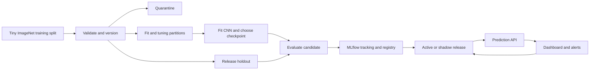

# Tiny ImageNet classification

This project proposes a class for a 64 × 64 image so a reviewer can confirm or correct the label. A residual CNN trains from scratch on Tiny ImageNet. Release decisions use an internal holdout and a majority-class baseline. The homework notebook retains its original code and outputs. [Project requirements](docs/requirements.md) · [Homework 2 guidelines](docs/homework-guidelines.md) · [tiny-imagenet-classifier.ipynb](notebooks/tiny-imagenet-classifier.ipynb)



## Run locally

With Python 3.12 and `uv` available, run:

```bash
make demo
```

This command installs the project, trains a small synthetic fixture on-device, applies the release gate, registers the accepted model in MLflow, and starts the HTTP service. Open [the local dashboard](http://127.0.0.1:8080/dashboard). In a second terminal, verify the HTTP latency target:

```bash
.venv/bin/python -m tiny_imagenet.load_test
```

Use actual Tiny ImageNet training images with the `smoke` or `full` profile. The full profile targets 450 fit, 30 tuning, and 20 gate images per class before accounting for quarantined rows. It uses 75 as the epoch cap with patience 10 on tuning accuracy. A fresh full run can take substantial time on CPU. If the dataset is already cached, `--arrow /path/to/tiny-imagenet-train.arrow` accepts the original training Arrow file. Use a GPU or Apple Silicon when available.

```bash
make demo PROFILE=full
# To train and attempt registration without starting the service
.venv/bin/python -m tiny_imagenet --state .state/full train --profile full
```

The API accepts JPEG or PNG bytes directly. It returns a class index, a dataset label such as a WordNet ID, a request ID, and a release ID. It abstains with HTTP 503 when inference is unavailable. The dashboard shows drift, latency, fallback rate and quality metrics once feedback is available.

```bash
curl -fsS -H 'Content-Type: application/octet-stream' \
  --data-binary @image.png http://127.0.0.1:8080/predict
```

## Verify and release

- `make check` runs Ruff, mypy and tests. The tests exercise repeatable data outputs, quarantine, MLflow registration, gate rejection, drift alerts, fallback, shadow inference and rollback.
- Add `--shadow` to `train` to register an eligible candidate for shadow traffic. The service observes it without routing its prediction to the caller. Run `promote` to recheck the gate and switch the active release. Run `rollback` to restore the previous bundle. Use the service's state directory for each command. [Runbook](docs/runbook.md)
- Export the active model and build the service image. Use the Terraform configuration for an authenticated, scale-to-zero Cloud Run demonstration. [Deployment steps](docs/deployment.md)

## Results and limitations

| Check | Observed result |
| --- | --- |
| Full data preparation | 90,000 fit, 6,000 tuning, 4,000 gate images, zero quarantined. Two independent runs produced byte-identical artifacts. |
| Real-data smoke candidate | Six epochs on 1,600 fit images. Holdout accuracy 2.50% and macro F1 1.42%. The candidate passed the 0.50% accuracy majority baseline and was registered. |
| Synthetic fixture | 75.00% gate accuracy and 66.67% macro F1 on 16 synthetic gate images |
| Local HTTP latency | 9.3 ms p95 over 50 sequential warmed requests against the synthetic fixture, with a 250 ms target |
| Local Docker image | Health, prediction, and metrics endpoints passed. The synthetic fixture served 10 warmed requests at 24.8 ms p95. |

The saved homework log shows **51.11% internal tuning accuracy at epoch 75** of a run configured for 80 epochs. The project uses a different holdout and release gate. The smoke and fixture results above verify the pipeline at reduced scale. A full-data project model requires a fresh training and evaluation run. [Homework training log](notebooks/tiny-imagenet-classifier.ipynb)

The release gate is a point-estimate comparison on a fixed holdout. Repeated tuning against the gate reduces its value as independent evidence. Monitoring uses local SQLite and measures quality on the subset of requests with feedback, which can be biased. Cloud demo telemetry lasts for the life of the instance. Local p95 describes the documented warmed serial workload.
