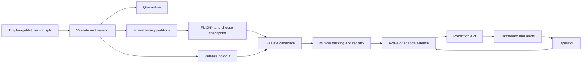

# Tiny ImageNet classification

This project proposes a class for a 64 × 64 image so a reviewer can confirm or correct the label. A residual CNN trains from scratch on Tiny ImageNet. Release decisions use an internal holdout and a majority-class baseline. The research notebook keeps its original code and outputs. [Project requirements](docs/requirements.md) · [System design](docs/design.md) · [tiny-imagenet-classifier.ipynb](notebooks/tiny-imagenet-classifier.ipynb)



The local demo is verified with the registered smoke model and synthetic fixture. Full-data training and the Cloud Run deployment are deferred. [Acceptance evidence](docs/design.md#acceptance-evidence)

## Run locally

### Serve an existing model

If `.state/smoke` already contains the registered smoke release, start the API directly:

```bash
.venv/bin/python -m tiny_imagenet --state .state/smoke serve
```

For Prometheus, Grafana, and an alert drill on a disposable copy, follow the [monitoring runbook](docs/runbook.md#local-monitoring-stack).

### Run the fixture from a fresh clone

With Python 3.12 and `uv` available, run:

```bash
make demo
```

This command installs the project, trains a small synthetic fixture on-device, applies the release gate, registers the accepted model in MLflow, and starts the HTTP service. Open [the local dashboard](http://127.0.0.1:8080/dashboard). In a second terminal, verify the HTTP latency target:

```bash
.venv/bin/python -m tiny_imagenet.load_test
```

### Train on real images

Use actual Tiny ImageNet training images with the `smoke` or `full` profile. The full profile targets 450 fit, 30 tuning, and 20 gate images per class before accounting for quarantined rows. It uses 75 as the epoch cap with patience 10 on tuning accuracy. A fresh full run can take substantial time on CPU. If the dataset is already cached, `--arrow /path/to/tiny-imagenet-train.arrow` accepts the original training Arrow file. Use a GPU or Apple Silicon when available.

```bash
make demo PROFILE=full
# To train and attempt registration without starting the service
.venv/bin/python -m tiny_imagenet --state .state/full train --profile full
```

The API accepts JPEG or PNG bytes directly. It returns a class index, a dataset label such as a WordNet ID, a request ID, and a release ID. It abstains with HTTP 503 when inference is unavailable. The dashboard shows drift, latency, fallback rate and quality metrics once feedback is available.

```bash
curl -fsS -H 'Content-Type: application/octet-stream' \
  --data-binary @image.png http://127.0.0.1:8080/predict
```

## Verify and release

- `make check` runs Ruff, mypy and tests. The tests exercise repeatable data outputs, quarantine, MLflow registration, gate rejection, drift alerts, fallback, shadow inference and rollback.
- Add `--shadow` to `train` to register an eligible candidate for shadow traffic. The service observes it without routing its prediction to the caller. Run `promote` to recheck the gate and switch the active release. Run `rollback` to restore the previous bundle. Use the service's state directory for each command. [Runbook](docs/runbook.md)
- Start the local Prometheus, Grafana, and Alertmanager stack with an existing release. [Monitoring runbook](docs/runbook.md#local-monitoring-stack)
- Export the active model and build the service image. Use the Terraform configuration for an authenticated, scale-to-zero Cloud Run demonstration. [Deployment steps](docs/deployment.md)

## Results and limitations

| Check | Observed result |
| --- | --- |
| Full data preparation | 90,000 fit, 6,000 tuning, 4,000 gate images, zero quarantined. Two independent runs produced byte-identical artifacts. |
| Real-data smoke candidate | Six epochs on 1,600 fit images. Holdout accuracy 2.50% and macro F1 1.42%. The candidate passed the 0.50% accuracy majority baseline and was registered. |
| Synthetic fixture | 75.00% gate accuracy and 66.67% macro F1 on 16 synthetic gate images |
| Local HTTP latency | 9.3 ms p95 over 50 sequential warmed requests against the synthetic fixture, with a 250 ms target |
| Smoke HTTP load | With the bounded queue, median p95 was 4.5 ms at concurrency 1 and 12.5 ms at concurrency 4. At concurrency 4, fallbacks dropped from 327 of 400 requests to zero. [Benchmark details](docs/design.md#bounded-queue-benchmark) |
| Local monitoring | Prometheus scraped the smoke service and Grafana displayed its metrics. A simulated missing-weights outage returned HTTP 503. Alertmanager delivered firing and resolved notifications to the local webhook. |
| Local Docker image | Health, prediction, and metrics endpoints passed. The synthetic fixture served 10 warmed requests at 24.8 ms p95. |
| Fresh clone, one command | `make demo` on a clean clone of commit `80b4e31` installed, trained, registered and served the synthetic fixture in about 155 s. 50 warmed requests ran at 4.0 ms p95. Removing the weights returned HTTP 503 fallback and raised `fallback_rate_high`. The served model recorded its Git commit, data version, MLflow run and registry version. |
| Continuous integration | GitHub Actions runs Ruff, mypy and the test suite on every pull request and every push to `main`. |

The saved notebook log shows **51.11% internal tuning accuracy at epoch 75** of a run configured for 80 epochs. The project uses a different holdout and release gate. The smoke and fixture results above verify the pipeline at reduced scale. A full-data project model requires a fresh training and evaluation run. [Notebook training log](notebooks/tiny-imagenet-classifier.ipynb)

The release gate compares point estimates on a fixed holdout. Repeated tuning against that holdout reduces its independence. The active worker allows up to three waiting requests. Saturation and deadline expiry still return HTTP 503. Feedback metrics cover the labeled subset and may be biased. The monitoring stack and notification receiver were verified locally. [Design and limitations](docs/design.md#skipped-and-incomplete-parts)
