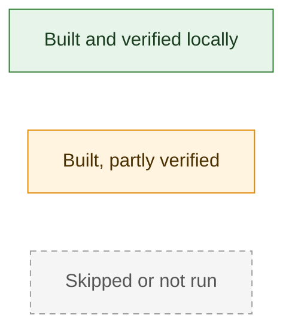
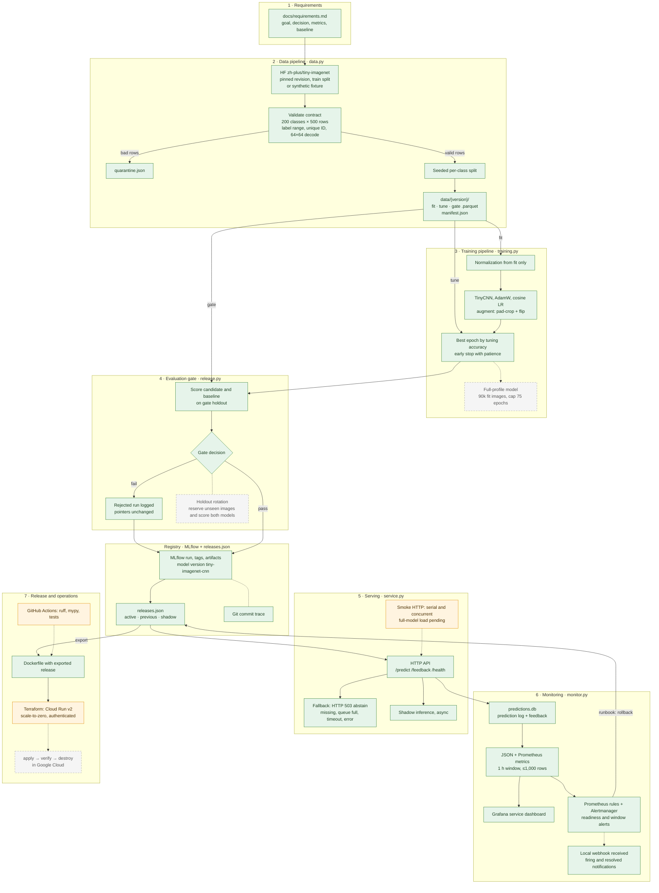
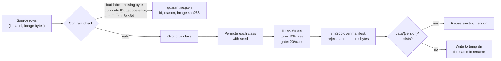
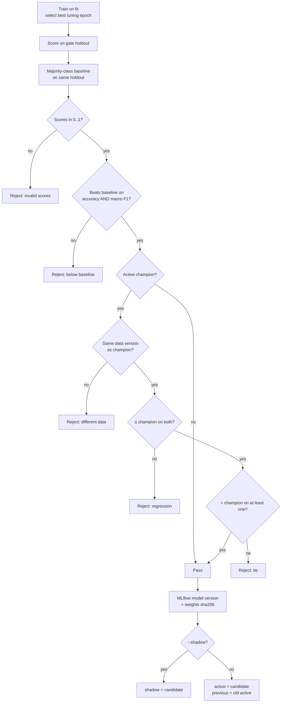
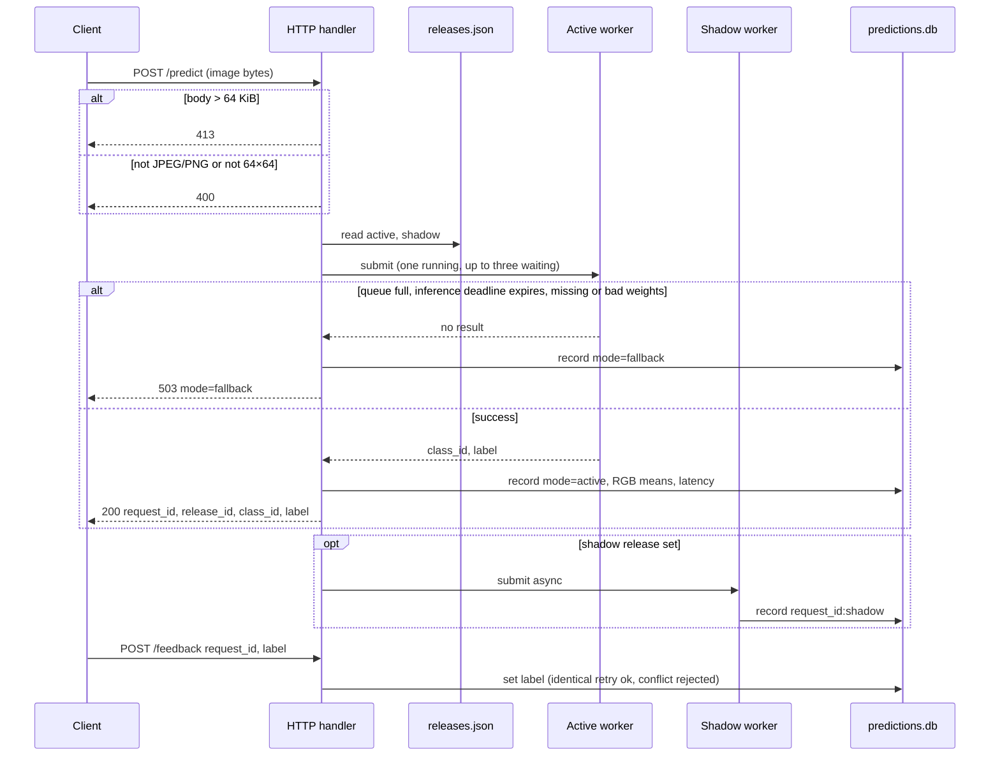
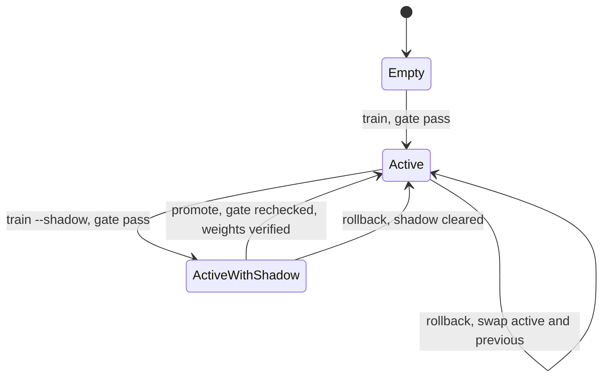

# System design

This page shows how the Tiny ImageNet classifier moves from raw images to a served, monitored release, and which parts of the end-to-end standard are still open. Requirements live in [requirements.md](requirements.md). Operating steps live in [runbook.md](runbook.md) and [deployment.md](deployment.md).

## Framing

| Item | Value |
| --- | --- |
| Business goal | Speed up image labeling by proposing a class that a reviewer confirms or corrects. |
| Decision | Show the proposed class, or abstain so a reviewer labels the image without a suggestion. |
| Input | JPEG or PNG bytes, 64 × 64, up to 64 KiB, grayscale allowed. |
| Output | `class_id`, dataset label (WordNet ID), `request_id`, `release_id`, `mode`. |
| ML task | Supervised 200-class image classification, residual CNN trained from scratch. |
| Offline metrics | Accuracy and macro F1 on the gate holdout. |
| Online metrics | p95 latency, fallback rate, RGB mean shift, accuracy and macro F1 on feedback. |
| Non-ML baseline | Always predict the most frequent class in the fit partition. |

## Legend

Every diagram uses the same styles.

## End-to-end flow

`make demo` runs the local chain for the synthetic fixture: prepare → train → evaluate → register → serve. The load test runs from a second terminal.

## Data pipeline

The version is a content hash, so the same input, seed and profile produce the same directory. A rerun returns the existing version. The full run prepared 90,000 fit, 6,000 tuning and 4,000 gate images with zero quarantined. The official `valid` split never enters this pipeline because the research notebook reserves it for the final evaluation.

## Training and evaluation gate

Rejected candidates are logged in MLflow with `gate=rejected` and `gate_reason`. The current gate rejects a candidate evaluated on a different data version from the champion. That guard stays in place until the holdout rotation plan below is implemented.

## Serving request path

The active worker checks the weights' sha256 before loading a release and caches one model in memory. The default one-second inference deadline includes queue wait and model execution. An expired queued request skips model execution. A running request keeps its slot until execution finishes, even when its caller has already received HTTP 503.

## Bounded queue benchmark

Four alternating trials used the same local 200-class smoke model and image. Each trial sent 50 sequential warmed requests and 100 warmed requests at concurrency four. The table reports the median of each trial's p95 and the total fallbacks.

| Workload | Overall p95 before | Overall p95 with queue | Fallbacks before | Fallbacks with queue |
| --- | ---: | ---: | ---: | ---: |
| Sequential | 3.9 ms | 4.5 ms | 0 / 200 | 0 / 200 |
| Concurrency 4 | 8.6 ms | 12.5 ms | 327 / 400 | 0 / 400 |

At concurrency four, p95 for successful predictions was 8.9 ms before the change and 12.5 ms with the queue. The queue traded additional waiting latency for fewer fallbacks under this workload. The 250 ms target applies to the sequential workload.

## Release states

A file lock serializes every pointer change. `export` copies only the active bundle into `release/` for the container.

## Monitoring and alerts

| Alert | Rule | Minimum sample |
| --- | --- | --- |
| `fallback_rate_high` | Fallback share > 10% | 1 request |
| `latency_high` | p95 > 250 ms | 1 request |
| `input_drift` | Max channel RGB mean shift vs fit mean > 0.15 | 20 requests |
| `feedback_accuracy_low` | Feedback accuracy < gate accuracy − 0.15 | 20 labeled |

Alert flags appear in the `/metrics` JSON, the built-in dashboard, and the Prometheus scrape. The local Compose stack evaluates those flags and readiness in Prometheus, plots the metrics in Grafana, and routes notifications through Alertmanager to a local webhook. [Monitoring runbook](runbook.md#local-monitoring-stack)

## Cloud deployment path

```mermaid
flowchart LR
    E["export active release"]:::done --> D["build Cloud Run image<br/>linux/amd64"]:::skipped
    D --> P["push to existing<br/>Artifact Registry"]:::skipped
    P --> I["terraform init + validate"]:::partial
    I --> A["terraform apply<br/>image by digest"]:::skipped
    A --> V["authenticated /health<br/>and /predict"]:::skipped
    V --> X["terraform destroy"]:::skipped

    classDef done fill:#e6f4ea,stroke:#2e7d32,color:#1b3d1f
    classDef partial fill:#fff4e0,stroke:#e08a00,color:#4a2f00
    classDef skipped fill:#f5f5f5,stroke:#9e9e9e,color:#555,stroke-dasharray:5 4
```

Local container verification used a synthetic release on `linux/arm64`. The `linux/amd64` image build and push for Cloud Run are pending. Terraform initialized and validated locally. Cloud Run is configured for one instance at most, concurrency 1, scale to zero, 2 vCPU, 2 GiB, and a 15 s request timeout. SQLite in the container is lost when the instance stops.

## Stage status

| Stage | Status | Evidence |
| --- | --- | --- |
| 1 · Requirements | Done | [requirements.md](requirements.md) |
| 2 · Data pipeline | Done | Contract, quarantine, content-hashed Parquet. Full data prepared twice with byte-identical output. |
| 3 · Training pipeline | Partial | Fixture and smoke runs registered. No full-profile model exists in `.state/full`. |
| 4 · Evaluation gate | Done | A smoke candidate below baseline was rejected. Integration tests separately cover a baseline tie and a candidate that beats the baseline but regresses against the champion. |
| 5 · Serving | Partial | The fixture verified shadow traffic. The 200-class smoke model met the sequential latency target and recovered after a simulated missing-weights outage. The bounded queue reduced fallbacks at concurrency four from 327 of 400 requests to zero in the local comparison. Full-model and cloud tests are pending. |
| 6 · Monitoring | Partial | Prometheus scraped the smoke service and Grafana queried its provisioned data source. Alertmanager delivered firing and resolved notifications for a simulated missing-weights outage to the local webhook. A remote notification destination and cloud monitoring remain open. |
| 7 · Release and operations | Partial | CI runs on GitHub for every pull request and every push to `main`. Dockerfile, Terraform config, shadow release and rollback exist. Cloud deploy has not run. |
| 8 · Documentation | Done for the local demo | README, runbook, acceptance evidence, and release-gate explanation are available. The from-memory explanation and reading comparison remain open. |

## Acceptance evidence

| Check | Evidence | Scope |
| --- | --- | --- |
| Fresh clone runs the pipeline | `make demo` on commit `80b4e31` installed, trained, registered, served, and monitored a synthetic fixture. | Local fixture |
| Deterministic data and quarantine | Full data preparation produced byte-identical artifacts on repeat. A fixture test quarantined an injected malformed image. | Real-data preparation and fixture test |
| Release gate blocks regressions | Integration tests reject a baseline tie and a candidate whose macro F1 regresses against the champion. The active release stays in place. | Local integration tests |
| Latency and fallback | The smoke model met the sequential p95 target in all four trials with the queue. At concurrency four, all 400 requests completed. Removing weights still returned HTTP 503. | Local smoke release and simulated outage |
| Monitoring and recovery | Prometheus scraped the smoke service, Grafana read its metrics, and Alertmanager sent firing and resolved notifications to the local webhook. Restoring the weights recovered active predictions. A separate integration test exercised shadow traffic, promotion, and rollback. | Local incident drill and integration test |
| Model lineage | The fresh-clone fixture recorded its Git commit, data version, MLflow run and registry version. The older smoke release has a data version and MLflow record. Its Git commit field is empty. | Verified on the fresh-clone fixture |
| Immutable cloud revision and teardown | Terraform initialized and validated locally. Cloud deployment, verification and teardown are deferred while cloud access is unavailable. | Local configuration verification |

## Explain and design checks

**Explain the release gate in five minutes.** Walk through the failure it prevents, what each partition is for, and how a candidate becomes active. Fit updates the weights. Tuning selects the checkpoint. The gate compares the frozen checkpoint against the majority baseline and, when present, the active champion. Accuracy and macro F1 must both beat the baseline. For example, a candidate with higher accuracy and lower macro F1 than the champion is rejected. The guard protects average per-class F1, and it can also block a candidate whose small apparent regression is sampling noise. A passing candidate can receive shadow traffic before promotion. Rollback restores the previous release pointer.

**Design answer for holdout rotation.** Repeated release comparisons can turn a fixed holdout into a source of tuning feedback. Choosing which changes to keep based on observed gate scores favors changes that exploit chance patterns in that particular set. Merely reseeding the split also risks putting previously seen data into the new gate. In the project replay from seed 42 to 43, 3,599 of 4,000 new gate images had been in fit and 241 in tuning. The prepared seed-42 snapshot also has four tuning images and one gate image with byte-identical copies in fit.

Reserve a labeled holdout that neither frozen model has seen during fit or tuning, or collect fresh labeled images for the project. Check IDs and image hashes against both models' data, and retain the holdout's version and fingerprint. Evaluate the frozen candidate, champion, and baseline on those same images. Use those scores for the decision and retain the reports with the release. The notebook's official evaluation split stays reserved for the notebook.

**Remaining practice.** Give the explanation from memory and compare the written answer with the assigned chapter. Record a difference and how it changes the proposed design, or record that the two agree. [Design prompt](requirements.md)

## Delivery priorities

1. **Register the first full-data model.** Train from scratch using the 75-epoch cap and tuning-based early stopping. Record both holdout metrics, the baseline, and the MLflow model version.
2. **Verify serving and monitoring.** The registered smoke model covers the local workloads and alert drill while full training is deferred. Repeat the serial and concurrent tests with the first full release. Track active-response p95 and fallback rate under concurrent load.
3. **Verify the cloud release when access is available.** Build and smoke-test the `linux/amd64` image, deploy by digest, verify authenticated predictions, and record teardown.

## Skipped and incomplete parts

These items record open work and design choices.

1. **Full-profile model.** `.state/full` holds prepared data, with no saved full-model weights or `releases.json`. Registered models are the synthetic fixture (75.00% gate accuracy) and the smoke candidate (2.50%). Close it with `python -m tiny_imagenet --state .state/full train --profile full` on a GPU or Apple Silicon, then record the gate scores.
2. **Cloud deploy, verify and teardown.** Deferred while cloud access is unavailable. Resume with the target-architecture image and record the authenticated endpoint and post-destroy checks. [Deployment runbook](deployment.md)
3. **CI scope.** GitHub Actions runs Ruff, mypy and the test suite on every pull request and every push to `main`. It does not build the container image or run `terraform validate`.
4. **Holdout rotation.** The current gate rejects a data-version mismatch. A replacement holdout and its validation workflow remain future work. [Rotation design](#explain-and-design-checks)
5. **Alert delivery outside the local stack.** Firing and resolved notifications reached the local webhook. Routing to a hosted or team destination remains open.
6. **Load test scope.** The 4-class fixture and 200-class smoke release were measured locally. Repeat the serial and concurrent workloads on the full-data release and on Cloud Run.
7. **Canary release.** Only shadow is implemented. No traffic split sends a share of real responses to the candidate. The standard accepts shadow, so this is a design choice.
8. **Persistent monitoring in the cloud.** SQLite lives in the container and disappears on scale-down. Close it with an external store such as Cloud SQL or BigQuery.
9. **Drift coverage.** Drift checks only the per-channel RGB mean. Prediction-class distribution, image size mix and sharpness are not tracked.
10. **Feedback endpoint access.** `/feedback` trusts any caller locally. In Cloud Run, IAM authentication covers the whole service, but there is no per-reviewer identity.
11. **Gate statistics.** The gate compares point estimates on 4,000 images with no confidence interval. Small gains can be noise.
12. **Shared Terraform module.** The standard asks for the shared module. This project uses a standalone `main.tf`, and the Artifact Registry repository and service account are created outside Terraform.
13. **Notebook 75-epoch run.** The research notebook's saved log comes from an 80-epoch run. A run configured for 75 epochs has not been executed, so its result is unverified.
