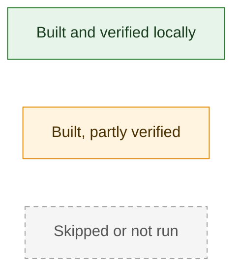
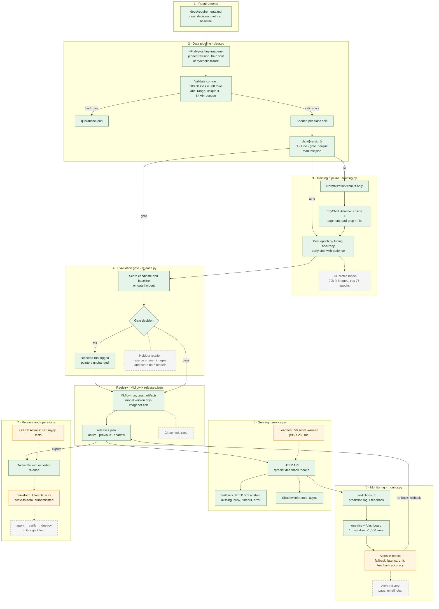
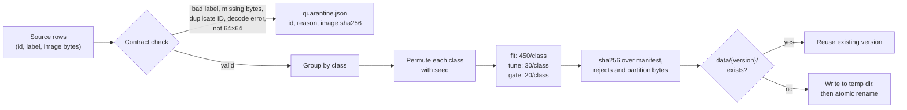
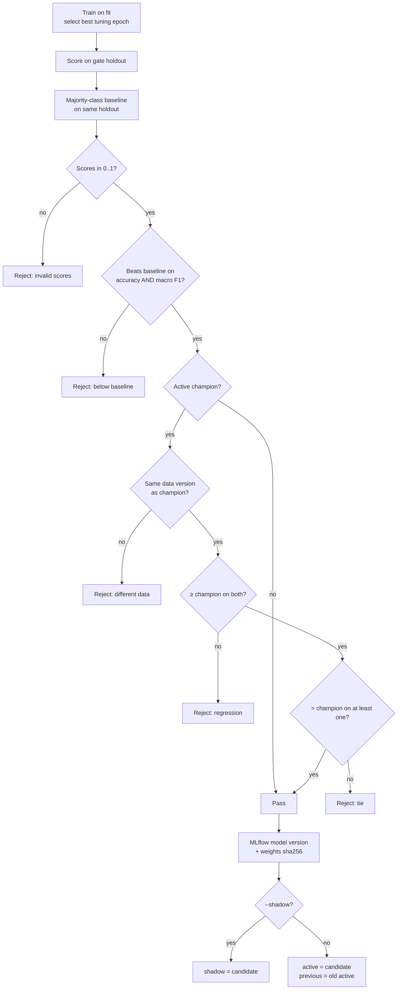
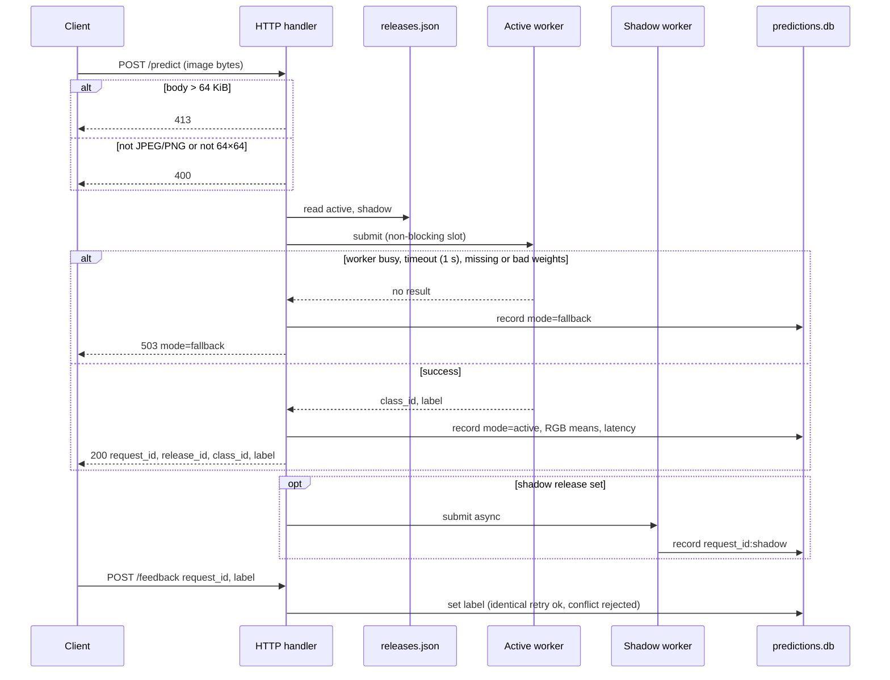
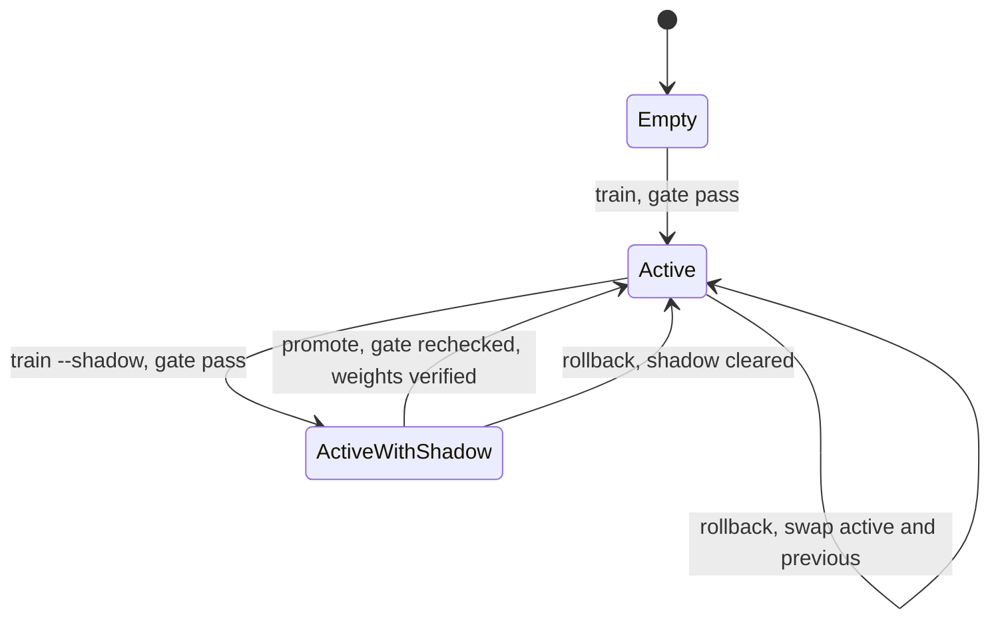

# System design

This page shows how the Tiny ImageNet classifier moves from raw images to a served, monitored release, and which parts of the end-to-end standard are still open. Requirements live in [requirements.md](requirements.md). Operating steps live in [runbook.md](runbook.md) and [deployment.md](deployment.md).

## Framing

| Item | Value |
| --- | --- |
| Business goal | Speed up image labeling by proposing a class that a reviewer confirms or corrects. |
| Decision | Show the proposed class, or abstain so a reviewer labels the image without a suggestion. |
| Input | JPEG or PNG bytes, 64 × 64, up to 64 KiB, grayscale allowed. |
| Output | `class_id`, dataset label (WordNet ID), `request_id`, `release_id`, `mode`. |
| ML task | Supervised 200-class image classification, residual CNN trained from scratch. |
| Offline metrics | Accuracy and macro F1 on the gate holdout. |
| Online metrics | p95 latency, fallback rate, RGB mean shift, accuracy and macro F1 on feedback. |
| Non-ML baseline | Always predict the most frequent class in the fit partition. |

## Legend

Every diagram uses the same styles.

## End-to-end flow

`make demo` runs the local chain for the synthetic fixture: prepare → train → evaluate → register → serve. The load test runs from a second terminal.

## Data pipeline

The version is a content hash, so the same input, seed and profile produce the same directory. A rerun returns the existing version. The full run prepared 90,000 fit, 6,000 tuning and 4,000 gate images with zero quarantined. The official `valid` split never enters this pipeline because the classroom notebook reserves it for final grading.

## Training and evaluation gate

Rejected candidates are logged in MLflow with `gate=rejected` and `gate_reason`. The current gate rejects a candidate evaluated on a different data version from the champion. That guard stays in place until the holdout rotation plan below is implemented.

## Serving request path

The active worker checks the weights' sha256 before loading a release and caches one model in memory.

## Release states

A file lock serializes every pointer change. `export` copies only the active bundle into `release/` for the container.

## Monitoring and alerts

| Alert | Rule | Minimum sample |
| --- | --- | --- |
| `fallback_rate_high` | Fallback share > 10% | 1 request |
| `latency_high` | p95 > 250 ms | 1 request |
| `input_drift` | Max channel RGB mean shift vs fit mean > 0.15 | 20 requests |
| `feedback_accuracy_low` | Feedback accuracy < gate accuracy − 0.15 | 20 labeled |

Alerts appear in the `/metrics` JSON and on `/dashboard`. Nothing pushes them anywhere. The response for each alert is in [runbook.md](runbook.md).

## Cloud deployment path

```mermaid
flowchart LR
    E["export active release"]:::done --> D["build Cloud Run image<br/>linux/amd64"]:::skipped
    D --> P["push to existing<br/>Artifact Registry"]:::skipped
    P --> I["terraform init + validate"]:::partial
    I --> A["terraform apply<br/>image by digest"]:::skipped
    A --> V["authenticated /health<br/>and /predict"]:::skipped
    V --> X["terraform destroy"]:::skipped

    classDef done fill:#e6f4ea,stroke:#2e7d32,color:#1b3d1f
    classDef partial fill:#fff4e0,stroke:#e08a00,color:#4a2f00
    classDef skipped fill:#f5f5f5,stroke:#9e9e9e,color:#555,stroke-dasharray:5 4
```

Local container verification used a synthetic release on `linux/arm64`. The `linux/amd64` image build and push for Cloud Run are pending. Terraform initialized and validated locally. Cloud Run is configured for one instance at most, concurrency 1, scale to zero, 2 vCPU, 2 GiB, and a 15 s request timeout. SQLite in the container is lost when the instance stops.

## Stage status

| Stage | Status | Evidence |
| --- | --- | --- |
| 1 · Requirements | Done | [requirements.md](requirements.md) |
| 2 · Data pipeline | Done | Contract, quarantine, content-hashed Parquet. Full data prepared twice with byte-identical output. |
| 3 · Training pipeline | Partial | Fixture and smoke runs registered. No full-profile model exists in `.state/full`. |
| 4 · Evaluation gate | Done | A smoke candidate below baseline was rejected. Integration tests separately cover a baseline tie and a candidate that beats the baseline but regresses against the champion. |
| 5 · Serving | Partial | Local HTTP inference, missing-weights fallback and shadow traffic were verified. The timeout is implemented. The timed HTTP check used the synthetic fixture. |
| 6 · Monitoring | Partial | SQLite prediction logs, the built-in dashboard, and four alert rules exist. The local incident test exercised fallback and RGB drift alerts. Prometheus, Grafana, and alert delivery are planned. |
| 7 · Release and operations | Partial | CI file, Dockerfile, Terraform config, shadow release and rollback exist. CI and cloud deploy have not run. |
| 8 · Documentation | Partial | README framing, diagram, results and limitations. Explain and design checks are not written down. |

## Delivery priorities

1. **Register the first full-data model.** Train from scratch using the 75-epoch cap and tuning-based early stopping. Record both holdout metrics, the baseline, and the MLflow model version.
2. **Verify serving and monitoring with that release.** Run the documented warmed latency check on the full model. Add a separate concurrent workload and report the concurrency, p95, and fallback rate. Expose Prometheus-compatible metrics, configure scraping and a Grafana dashboard, then inject a failure and confirm that the alert reaches its configured destination and clears after recovery.
3. **Verify the cloud release.** Build and smoke-test the `linux/amd64` image, deploy by digest, verify authenticated predictions, and record teardown. Hosted CI and commit lineage need a Git repository.

## Skipped and incomplete parts

These items record open work and design choices.

1. **Full-profile model.** `.state/full` holds only the prepared data version, with no `models/` or `releases.json`. Registered models are the synthetic fixture (75.00% gate accuracy) and the smoke candidate (2.50%). Close it with `python -m tiny_imagenet --state .state/full train --profile full` on a GPU or Apple Silicon, then record the gate scores.
2. **Cloud deploy, verify and teardown.** `infra/terraform` has `.terraform/` and a lock file but no state file, so `init` ran and `apply` did not. No image was pushed. Close it by following [deployment.md](deployment.md) end to end and recording the URL check and the post-destroy check.
3. **Git commit trace.** The folder is not a Git repository, so every model records `git_commit: null` and MLflow shows `unavailable`. Models still trace to `code_sha256` and `data_version`. Close it by initializing the repository and retraining.
4. **CI run.** `.github/workflows/ci.yml` exists, but there is no repository or remote for it to run on. It also does not build the image or run `terraform validate`. Close it by pushing to GitHub and checking the first run.
5. **Holdout rotation.** The current gate rejects a data-version mismatch. Rotating by changing the split seed exposes the comparison to leakage. When the full-data split seed changed from 42 to 43 in a read-only check, 3,599 of the 4,000 new gate images came from the original fit partition and 241 came from tuning. Reserve a separate labeled holdout before training any model that it may evaluate, or collect fresh labeled images for the project. Keep the official classroom evaluation split reserved for the homework. Record a separate holdout version and fingerprint its image IDs and content hashes. Before comparing, check that the new holdout is disjoint from the fit and tuning records of both models, including duplicate image bytes. Then score the frozen candidate and champion on that same holdout and retain both reports. A replacement holdout and its validation workflow remain future work.
6. **Prometheus, Grafana, and alert delivery.** The current `/metrics` endpoint returns JSON and the built-in dashboard reads SQLite. Expose a Prometheus-compatible endpoint and use Grafana for time-series dashboards. Configure notification routing and verify an injected alert and recovery.
7. **Load test scope.** 50 sequential requests on a local machine against the 4-class fixture. Concurrent load, the 200-class model and the cloud service are untested. Close it by rerunning against the full model and the Cloud Run URL.
8. **Canary release.** Only shadow is implemented. No traffic split sends a share of real responses to the candidate. The standard accepts shadow, so this is a design choice.
9. **Persistent monitoring in the cloud.** SQLite lives in the container and disappears on scale-down. Close it with an external store such as Cloud SQL or BigQuery.
10. **Drift coverage.** Drift checks only the per-channel RGB mean. Prediction-class distribution, image size mix and sharpness are not tracked.
11. **Feedback endpoint access.** `/feedback` trusts any caller locally. In Cloud Run, IAM authentication covers the whole service, but there is no per-reviewer identity.
12. **Gate statistics.** The gate compares point estimates on 4,000 images with no confidence interval. Small gains can be noise.
13. **Shared Terraform module.** The standard asks for the shared module. This project uses a standalone `main.tf`, and the Artifact Registry repository and service account are created outside Terraform.
14. **Explain and design checks.** The holdout-rotation design question in [requirements.md](requirements.md) has no written answer or comparison with the reading.
15. **Notebook 75-epoch run.** The homework notebook's saved log comes from an 80-epoch run. A run configured for 75 epochs has not been executed, so its result is unverified.
